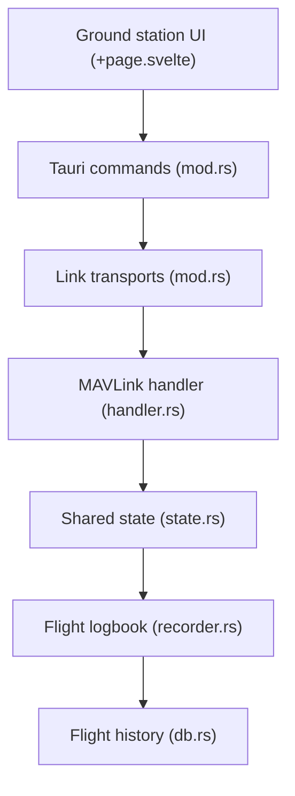

# b14ckyy/Kite-GC

> Cross-platform ground control station for INAV, ArduPilot and PX4 drones, for drone pilots.

## The problem
Planning, flying and logging flights often requires several separate programs depending on the autopilot.

## What it actually does
A single interface: live telemetry, 2D map and 3D view, mission planning, flight log with log import, fleet and battery managers, geofences, ADS-B radar, live video, telemetry relay. The Rust backend (Tauri 2) handles the links and protocols, the interface is in Svelte 5.

## How it is wired


## Trying it
```bash
npm install      # one-time
just dev         # start with hot reload  (alt: npm run tauri dev)
just build       # current platform   (alt: npm run tauri build)
```

## Cost and gotchas
Free. Build from source: Node.js LTS (v20 or v24), Rust via rustup, `just` and the platform's system dependencies. An installer is offered on the Releases page.

## What it is not
Not a data/AI tool. You need a compatible drone to really use it. GPL-3.0: derivatives must stay open.

## Alternatives
No alternative named in the README.

## For you
Ignore: outside your data / AI / MLOps scope, unless you fly drones.
