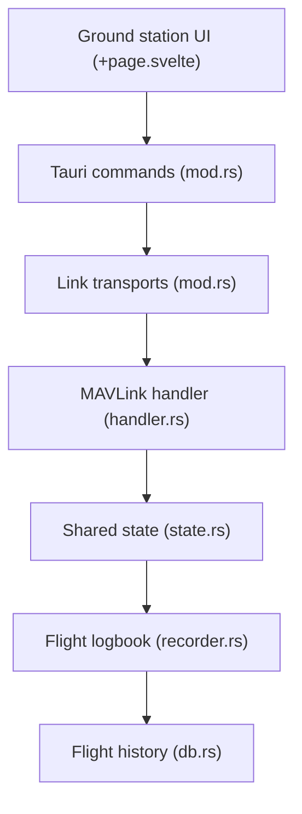

# b14ckyy/Kite-GC

> Station de contrôle au sol multiplateforme pour drones INAV, ArduPilot et PX4, pour pilotes de drones.

## Le problème
Planifier, piloter et journaliser des vols exige souvent plusieurs logiciels distincts selon l'autopilote.

## Ce que ça fait vraiment
Interface unique : télémétrie en direct, carte 2D et vue 3D, planification de missions, journal de vol avec import de logs, gestionnaires de flotte et de batteries, géofences, radar ADS-B, vidéo en direct, relais de télémétrie. Le backend Rust (Tauri 2) gère les liaisons et protocoles, l'interface est en Svelte 5.

## Comment c'est branché


## Essayer
```bash
npm install      # one-time
just dev         # start with hot reload  (alt: npm run tauri dev)
just build       # current platform   (alt: npm run tauri build)
```

## Coût et pièges
Gratuit. Compilation depuis les sources : Node.js LTS (v20 ou v24), Rust via rustup, `just` et les dépendances système de la plateforme. Un installateur est proposé sur la page Releases.

## Ce que ce n'est pas
Pas un outil data/IA. Il faut un drone compatible pour s'en servir vraiment. GPL-3.0 : les dérivés doivent rester ouverts.

## Alternatives
Aucune alternative nommée dans le README.

## Pour toi
Ignorer : hors de ton périmètre data / IA / MLOps, sauf si tu pilotes des drones.

