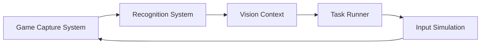

# babalae/better-genshin-impact

> Computer-vision automation for Genshin Impact (Windows), for players.

## The problem
The game's repetitive tasks (quests, fishing, resources) take time.

## What it actually does
Captures the game screen (BitBlt, DWM, Graphics Capture), recognizes the image (OpenCV, OCR, ONNX Runtime) and simulates keyboard/mouse: auto-pickup, dialogues, teleportation, fishing, secrets, cooking, music, macro recording. It does not touch the game's files or memory.

## How it is wired

## Trying it
No command in the README: download the package (.NET runtime included), launch it, choose the capture mode.

## Cost and gotchas
Free. Windows 10+ 64-bit, administrator rights, 16:9 only. Ban risk: the game's terms forbid third-party software. This is not a Python prerequisite: the .NET runtime is provided.

## What it is not
Not guaranteed free of ban risk. Not cross-platform.

## Alternatives
No alternative named in the README.

## For you
To ignore: out of scope, with an account risk; only the computer-vision angle might inspire you.
