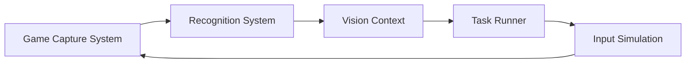

# babalae/better-genshin-impact

> Automatisation de Genshin Impact par vision par ordinateur (Windows), pour joueurs.

## Le problème
Les tâches répétitives du jeu (quêtes, pêche, ressources) prennent du temps.

## Ce que ça fait vraiment
Capture l'écran du jeu (BitBlt, DWM, Graphics Capture), reconnaît l'image (OpenCV, OCR, ONNX Runtime) et simule clavier/souris : ramassage auto, dialogues, téléportation, pêche, secrets, cuisine, musique, enregistrement de macros. Ne touche pas aux fichiers ni à la mémoire du jeu.

## Comment c'est branché

## Essayer
Aucune commande dans le README : télécharger le paquet (runtime .NET inclus), lancer, choisir le mode de capture.

## Coût et pièges
Gratuit. Windows 10+ 64 bits, droits administrateur, 16:9 uniquement. Risque de bannissement : les conditions du jeu interdisent les logiciels tiers. Ce n'est pas un prérequis Python : le runtime .NET est fourni.

## Ce que ce n'est pas
Pas garanti sans risque de bannissement. Pas multi-plateforme.

## Alternatives
Aucune alternative nommée dans le README.

## Pour toi
À ignorer : hors périmètre, avec un risque de compte ; seul l'angle vision par ordinateur pourrait t'inspirer.

