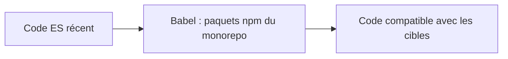

# babel/babel

> JavaScript compiler that rewrites recent syntax into code understood by older environments.

## The problem
New language features are not supported everywhere, which forces you to write older code.

## What it actually does
Transforms modern JavaScript into a version compatible with the targeted environments. README example: the `??` operator becomes `input != null ? input : "Hello world"`. The repo is a monorepo of many npm packages. The README provided is short and points to the website for documentation.

## How it is wired

Simplified diagram based on the sheet, no diagram provided.

## Trying it
```bash
# Aucune commande documentée dans le README fourni.
# Un REPL en ligne et le site babeljs.io sont cités.
```

## Cost and gotchas
Free, requires Node. The installation commands are not in this README: everything is deferred to the website.

## What it is not
Not a bundler nor a test runner. No type checking. Maintained by volunteers, funded by donations (Open Collective).

## Alternatives
No alternative named in the README.

## For you
Ignore: a JavaScript build chain unrelated to your data / AI pipelines, unless you maintain a web front end.
