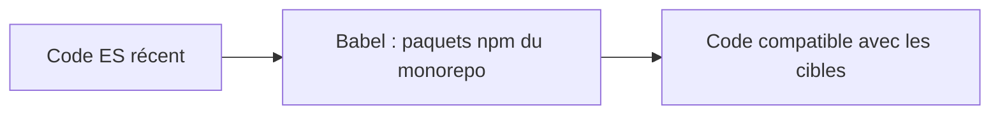

# babel/babel

> Compilateur JavaScript qui réécrit la syntaxe récente en code compris par des environnements plus anciens.

## Le problème
Les nouvelles fonctions du langage ne sont pas prises en charge partout, ce qui oblige à écrire du code plus ancien.

## Ce que ça fait vraiment
Transforme du JavaScript moderne en version compatible avec les environnements ciblés. Exemple du README : l'opérateur `??` devient `input != null ? input : "Hello world"`. Le dépôt est un monorepo de nombreux paquets npm. Le README fourni est court et renvoie au site pour la documentation.

## Comment c'est branché

Schéma simplifié d'après la fiche, sans diagramme fourni.

## Essayer
```bash
# Aucune commande documentée dans le README fourni.
# Un REPL en ligne et le site babeljs.io sont cités.
```

## Coût et pièges
Gratuit, nécessite Node. Les commandes d'installation ne figurent pas dans ce README : tout est renvoyé au site.

## Ce que ce n'est pas
Pas un empaqueteur (bundler) ni un lanceur de tests. Pas de vérification de types. Maintenu par des bénévoles, financé par dons (Open Collective).

## Alternatives
Aucune alternative nommée dans le README.

## Pour toi
À ignorer : chaîne de build JavaScript sans lien avec tes pipelines data / IA, sauf si tu maintiens un front web.

