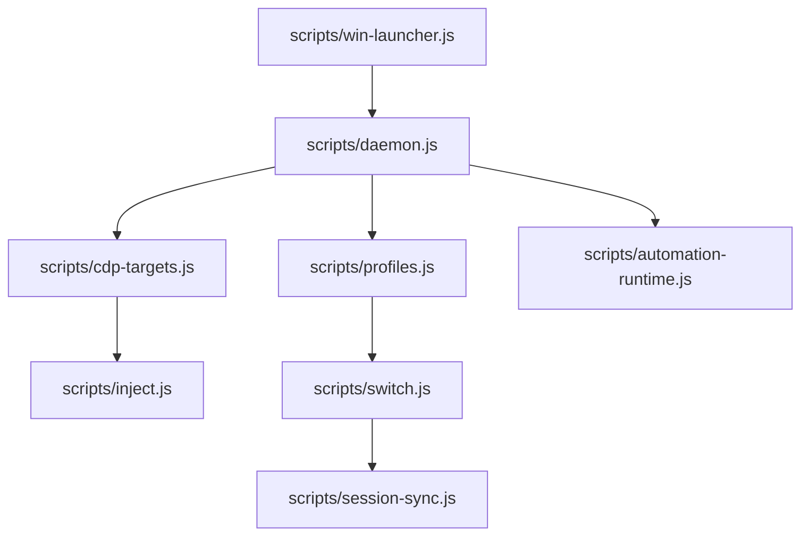

# babygoton/WorkDaddy

> Assistant that injects itself into the WorkBuddy and CodeBuddy desktop clients to manage accounts, sessions and tasks.

## The problem
The WorkBuddy and CodeBuddy clients force you to log in again each time you switch accounts and limit session and model management.

## What it actually does
A local daemon connects to the Electron client through the Chrome debugging protocol (port 9222), injects a panel and calls it through a local HTTP API. It saves accounts so you can switch between them without scanning a QR code, migrates sessions between accounts, manages models, applies themes, resumes after a disconnection and runs automated tasks described in JSON. Account exports are encrypted with AES-256-GCM.

## How it is wired


## Trying it
```bash
git clone https://github.com/babygoton/WorkDaddy.git
cd WorkDaddy
bash scripts/install-linux.sh
bash scripts/relaunch-with-cdp-linux.sh
sudo apt install ./CodeDaddy-CN_1.2.9_amd64.deb
```

## Cost and gotchas
Free, but you must install and connect the official client. Account exports contain login tokens to protect like a password. Errors are sent to Sentry by default (can be disabled in the About page or with WORKDADDY_TELEMETRY=0).

## What it is not
Not affiliated with the publishers of WorkBuddy and CodeBuddy, and not authorized by them. Not usable without their clients. AGPL license announced in the README but not identified by GitHub; the README also carries a sponsor advertisement.

## Alternatives
No alternative cited in the README.

## For you
Ignore: it handles account tokens of a specific Chinese client, unrelated to your field, and enables telemetry by default.
