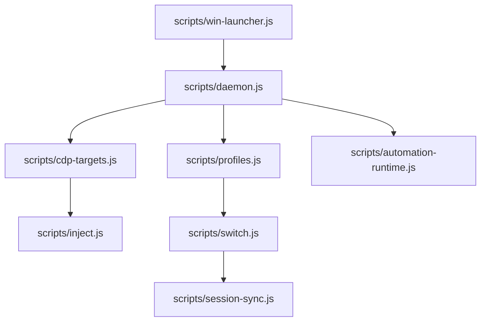

# babygoton/WorkDaddy

> Assistant qui s'injecte dans les clients de bureau WorkBuddy et CodeBuddy pour gérer comptes, sessions et tâches.

## Le problème
Les clients WorkBuddy et CodeBuddy obligent à se reconnecter à chaque changement de compte et limitent la gestion des sessions et des modèles.

## Ce que ça fait vraiment
Un démon local se connecte au client Electron par le protocole de débogage Chrome (port 9222), injecte un panneau et l'appelle via une API HTTP locale. Il sauvegarde les comptes pour les basculer sans scanner un QR, migre les sessions entre comptes, gère les modèles, applique des thèmes, relance après une coupure et exécute des tâches automatisées décrites en JSON. Les exports de comptes sont chiffrés en AES-256-GCM.

## Comment c'est branché


## Essayer
```bash
git clone https://github.com/babygoton/WorkDaddy.git
cd WorkDaddy
bash scripts/install-linux.sh
bash scripts/relaunch-with-cdp-linux.sh
sudo apt install ./CodeDaddy-CN_1.2.9_amd64.deb
```

## Coût et pièges
Gratuit, mais il faut installer et connecter le client officiel. Les exports de comptes contiennent des jetons de connexion à protéger comme un mot de passe. Les erreurs sont envoyées par défaut à Sentry (désactivable dans la page À propos ou par WORKDADDY_TELEMETRY=0).

## Ce que ce n'est pas
Pas affilié aux éditeurs de WorkBuddy et CodeBuddy, et non autorisé par eux. Pas utilisable sans leurs clients. Licence AGPL annoncée dans le README mais non identifiée par GitHub ; le README porte aussi une publicité de sponsor.

## Alternatives
Aucune alternative citée dans le README.

## Pour toi
Ignorer : il manipule des jetons de comptes d'un client chinois précis, sans lien avec ton métier, et active la télémétrie par défaut.

