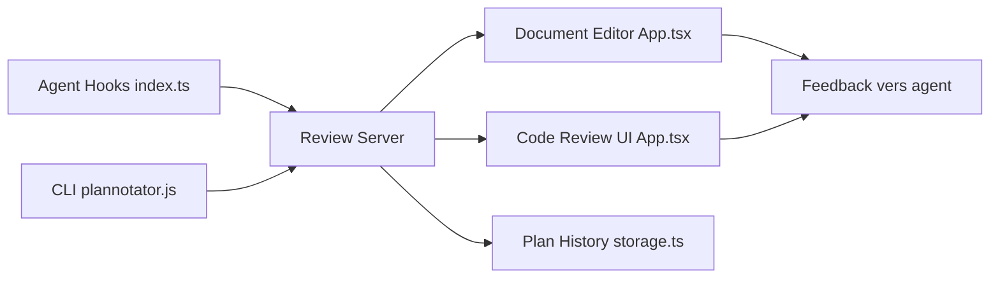

# backnotprop/plannotator

> Local browser review surface to annotate plans, diffs and messages from coding agents, then send the feedback back.

## The problem
A coding agent proposes a plan or a diff in a terminal, hard to comment on precisely. Feedback is free text, without line-by-line annotation.

## What it actually does
A local server opens a web interface when the agent proposes a plan (ExitPlanMode hook) or when you start a review. You annotate, approve or reject; the structured feedback goes back to the agent. It covers Claude Code, Codex, Copilot CLI, Gemini CLI, OpenCode, Pi, Amp, Droid, Kiro. Code review for Git, GitHub, GitLab, jj, p4. No telemetry; a GitHub request checks the latest version on load.

## How it is wired


## Trying it
```bash
curl -fsSL https://plannotator.ai/install.sh | bash
```
```text
/plannotator-last
/plannotator-review
/plannotator-annotate report.html
```

## Cost and gotchas
Free. "Ask AI" sends context to your configured provider. No option to turn off the version check. Link sharing is announced as deprecated; "Workspaces" is a separate hosted product.

## What it is not
Not an agent nor a replacement for GitHub PRs. Does not guarantee holding an agent on hold across all harnesses (Droid: commands only).

## Alternatives
- Herdr Annotate: same idea in the terminal, cited in the README.
- VS Code plugin from the same project: annotation from the editor.

## For you
Adopt if you often review agent plans and diffs: installation is light, data stays local and structured review reduces back-and-forth.
