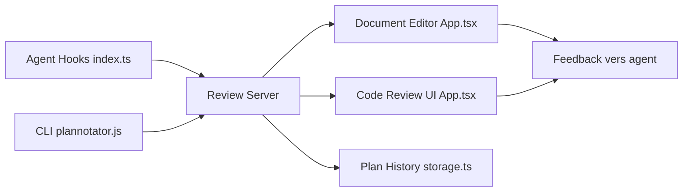

# backnotprop/plannotator

> Surface de revue locale dans le navigateur pour annoter plans, diffs et messages d'agents de code, puis renvoyer le retour.

## Le problème
Un agent de code propose un plan ou un diff dans un terminal, difficile à commenter précisément. Le retour se fait en texte libre, sans annotation ligne par ligne.

## Ce que ça fait vraiment
Un serveur local ouvre une interface web quand l'agent propose un plan (hook ExitPlanMode) ou quand tu lances une revue. Tu annotes, approuves ou refuses ; le retour structuré repart vers l'agent. Il couvre Claude Code, Codex, Copilot CLI, Gemini CLI, OpenCode, Pi, Amp, Droid, Kiro. Revue de code Git, GitHub, GitLab, jj, p4. Pas de télémétrie ; une requête GitHub vérifie la dernière version au chargement.

## Comment c'est branché


## Essayer
```bash
curl -fsSL https://plannotator.ai/install.sh | bash
```
```text
/plannotator-last
/plannotator-review
/plannotator-annotate report.html
```

## Coût et pièges
Gratuit. « Ask AI » envoie du contexte à ton fournisseur configuré. Pas d'option pour couper la vérification de version. Le partage par lien est annoncé comme déprécié ; « Workspaces » est un produit hébergé distinct.

## Ce que ce n'est pas
Pas un agent ni un remplaçant de GitHub PR. Ne tient pas un agent en attente de façon garantie sur tous les harnais (Droid : commandes seulement).

## Alternatives
- Herdr Annotate : même idée dans le terminal, cité dans le README.
- Plugin VS Code du même projet : annotation depuis l'éditeur.

## Pour toi
À adopter si tu relis souvent les plans et diffs d'agents : l'installation est légère, les données restent locales et la revue structurée réduit les allers-retours.

