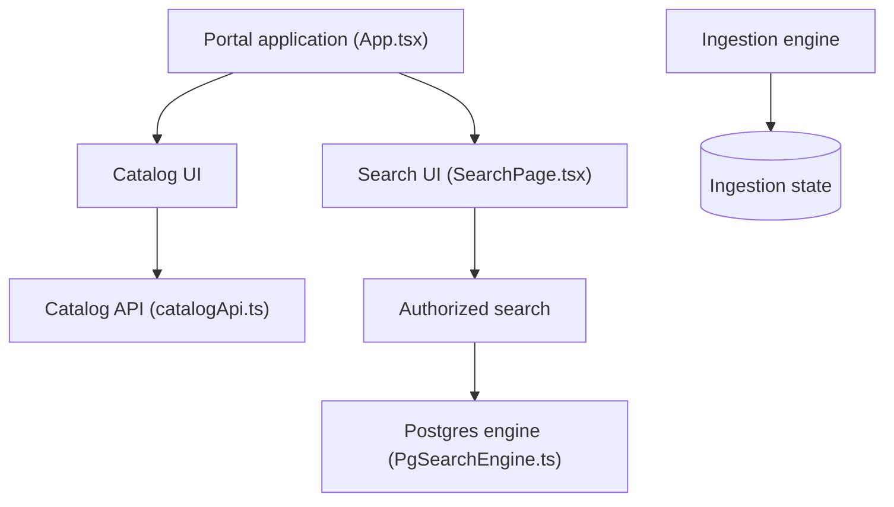

# backstage/backstage

> Open framework for building a developer portal around a central software catalog, born at Spotify.

## The problem
In a large organization, services, libraries, documentation and tools are scattered and hard to discover.

## What it actually does
A software catalog (microservices, libraries, data pipelines, ML models), project templates, TechDocs (documentation as code) and a plugin ecosystem. On the code side: incremental catalog ingestion with state kept in a database, authorized search with Lunr, Postgres or Elasticsearch engines, and authentication and permissions services.

## How it is wired

## Trying it
No command documented in the README; it points to the Getting Started guide.

## Cost and gotchas
Free, but running a portal takes a team: hosting, plugins, database. The details are not in the README.

## What it is not
Not a ready-to-use tool: it is a framework to assemble and maintain. It is not ML-specific, even though it can catalog models.

## Alternatives
No alternative named in the README.

## For you
Relevant if your MLOps platform has to catalog pipelines and models for several teams; too heavy for individual use: keep an eye on it.
