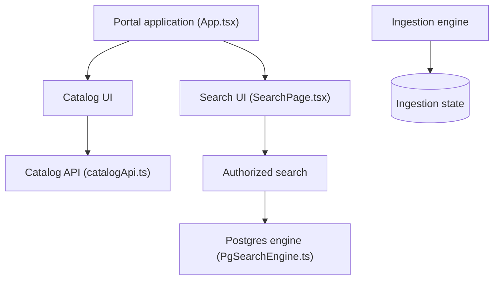

# backstage/backstage

> Cadre libre pour construire un portail développeur autour d'un catalogue central de logiciels, né chez Spotify.

## Le problème
Dans une grande organisation, services, bibliothèques, documentation et outils sont dispersés et mal découverts.

## Ce que ça fait vraiment
Un catalogue de logiciels (microservices, bibliothèques, pipelines de données, modèles de ML), des modèles de projets, TechDocs (documentation as code) et un écosystème de plugins. Côté code décrit : ingestion incrémentale du catalogue avec état en base, recherche autorisée avec moteurs Lunr, Postgres ou Elasticsearch, services d'authentification et de permissions.

## Comment c'est branché

## Essayer
Aucune commande documentée dans le README ; il renvoie au guide Getting Started.

## Coût et pièges
Gratuit, mais l'exploitation d'un portail demande une équipe : hébergement, plugins, base de données. Le détail n'est pas dans le README.

## Ce que ce n'est pas
Pas un outil prêt à l'emploi : c'est un cadre à assembler et à maintenir. Il n'est pas spécifique au ML, même s'il peut cataloguer des modèles.

## Alternatives
Aucune alternative nommée dans le README.

## Pour toi
Pertinent si ta plateforme MLOps doit cataloguer pipelines et modèles pour plusieurs équipes ; trop lourd pour un usage individuel : à surveiller.

