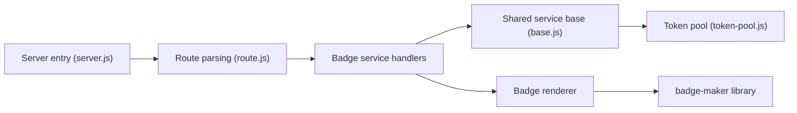

# badges/shields

> Shields.io SVG badge service, and badge-maker npm library, for READMEs and web pages.

## The problem
Displaying a project's status (version, CI, coverage, downloads) in a uniform way requires a generator that queries many sources.

## What it actually does
A Node server that receives a badge URL, picks a service (GitHub, npm, GitLab, dynamic JSON endpoints...), queries the third-party API, then renders an SVG or a raster image. A token queue in an SQL database protects API quotas such as GitHub's. The `badge-maker` library generates badges without the server. A Docusaurus site serves as a catalog. Prometheus or Influx metrics, Sentry optional.

## How it is wired


## Trying it
```bash
npm ci
npm start
npm run badge -- /npm/v/nock
```
then open `http://localhost:3000/` (Node 24 required according to the README).

## Cost and gotchas
The public service is free. Self-hosting requires tokens for quota-limited APIs and a database; the README points to a self-hosting guide.

## What it is not
It is not a code quality tool: it displays metrics computed elsewhere. A project's presence in awesome-badges is not an endorsement of the project.

## Alternatives
- No alternative named in the README (pointer to awesome-badges).

## For you
Keep an eye on it: useful to badge your repos with a simple link, no need to host it yourself unless you have a particular need.
