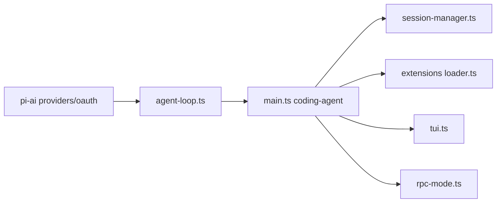

# badlogic/pi-mono

> A minimal code agent for the terminal, which can be extended with packages, featuring a TypeScript SDK and RPC mode.

## The problem
Embedded code agents enforce their functions (sub-agents, plan mode) and are difficult to customize.

## What it actually does
My Monorepo TypeScript: A multi-provider LLM API (pi-ai), an agent loop with tool calls (pi-agent-core), the pi-coding-agent CLI (sessions, compaction, skills, extensions, bash/reading/writing tools), and a TUI library. Interactive, printing, JSON, and RPC modes. No permission system: it works with your existing permissions.

## How it is wired


## Trying it
```bash
curl -fsSL https://pi.dev/install.sh | sh
# ou
npm install -g --ignore-scripts @earendil-works/pi-coding-agent
cd /path/to/project
pi
```
Then, type `/login` in pi to connect a subscription or API key.

## Cost and gotchas
Node 22.19+. The LLM vendor's invoice is your responsibility. No built-in isolation: the README refers to Docker, the micro-VM Gondolin, or OpenShell.

## What it is not
Not a "full-service" agent: sub-agents and the default plan are intentionally absent. There is no default sandbox. New contributions are automatically closed.

## Alternatives
- OpenClaw: cited as a real-world example of π integration.
- earendil-works/pi-chat: for automating Slack/chat.

## For you
Monitoring: The SDK and RPC make it a good foundation for building your own agent, but without a sandbox or multiple maintainers, it needs to be containerized before being deployed on real code.
