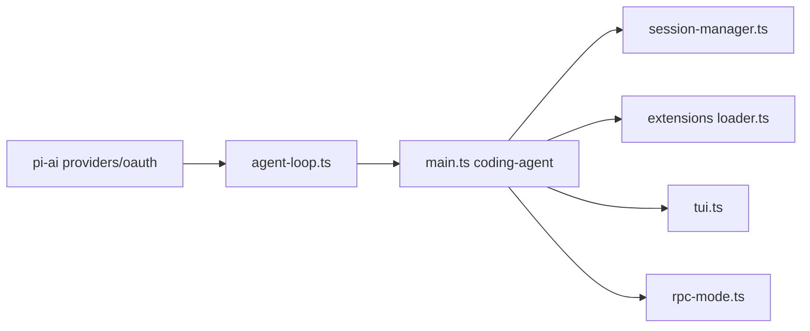

# badlogic/pi-mono

> Un agent de code minimal en terminal, extensible par paquets, avec SDK TypeScript et mode RPC.

## Le problème
Les agents de code intégrés imposent leurs fonctions (sous-agents, mode plan) et se personnalisent mal.

## Ce que ça fait vraiment
Monorepo TypeScript : une API multi-fournisseurs LLM (pi-ai), une boucle d'agent avec appel d'outils (pi-agent-core), le CLI pi-coding-agent (sessions, compaction, skills, extensions, outils bash/lecture/écriture) et une bibliothèque de TUI. Modes interactif, impression, JSON et RPC. Pas de système de permissions : tourne avec tes droits.

## Comment c'est branché


## Essayer
```bash
curl -fsSL https://pi.dev/install.sh | sh
# ou
npm install -g --ignore-scripts @earendil-works/pi-coding-agent
cd /path/to/project
pi
```
Puis `/login` dans pi pour connecter un abonnement ou une clé d'API.

## Coût et pièges
Node 22.19+. Facture du fournisseur LLM à ta charge. Aucune isolation intégrée : le README renvoie vers Docker, micro-VM Gondolin ou OpenShell.

## Ce que ce n'est pas
Pas un agent « tout compris » : sous-agents et mode plan sont volontairement absents. Pas de bac à sable par défaut. Les nouvelles contributions sont fermées automatiquement.

## Alternatives
- OpenClaw : cité comme intégration réelle de pi.
- earendil-works/pi-chat : pour l'automatisation Slack/chat.

## Pour toi
Surveiller : le SDK et le RPC en font une bonne base pour construire ton propre agent, mais sans sandbox ni mainteneur multiple il faut le conteneuriser avant de le lâcher sur du vrai code.

