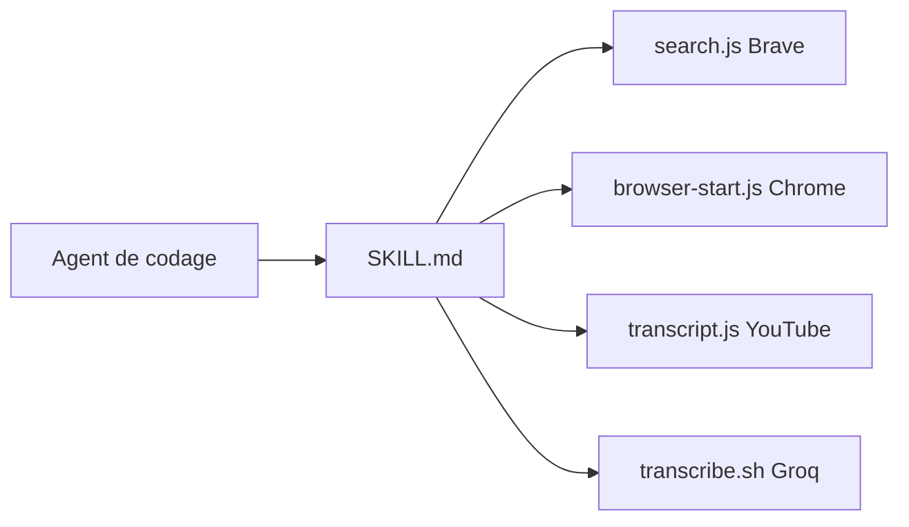

# badlogic/pi-skills

> Collection of skills (web search, browser, Google, transcription) for coding agents compatible with pi, Claude Code or Codex.

## The problem
Giving a coding agent web search, browser control or access to Gmail and Drive requires hand-writing tools for each agent.

## What it actually does
Eight skills as `SKILL.md` folders with Node scripts: `brave-search`, `browser-tools` (Chrome DevTools Protocol: start, navigate, evaluate, select, cookies, capture), `gccli`, `gdcli`, `gmcli` (Calendar, Drive, Gmail), `transcribe` (Groq Whisper), `vscode`, `youtube-transcript`. You clone the repository into the agent's skills folder.

## How it is wired


## Trying it
```bash
git clone https://github.com/badlogic/pi-skills ~/pi-skills
mkdir -p ~/.claude/skills
ln -s ~/pi-skills/brave-search ~/.claude/skills/brave-search
ln -s ~/pi-skills/youtube-transcript ~/.claude/skills/youtube-transcript
```

## Cost and gotchas
A Brave Search key or a Groq key depending on the skill. Claude Code reads only one folder level: symbolic links are needed. `gccli`, `gdcli` and `gmcli` give access to personal Google data. The prerequisites list mentions a `subagent` skill that is absent from the table.

## What it is not
Not an agent framework: these are tools to plug in. The Google, transcription and VS Code implementations were not examined in the architecture provided.

## Alternatives
No alternative named in the README.

## For you
Worth watching: `browser-tools` and `youtube-transcript` are useful building blocks for automated monitoring, provided you audit what the Google skills can read.
