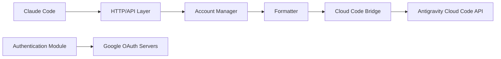

# badrisnarayanan/antigravity-claude-proxy

> Local proxy that translates the Anthropic API to Antigravity Cloud Code so you can use Claude and Gemini in Claude Code.

## The problem
Using Claude Code without direct Anthropic billing means routing your requests through another model provider.

## What it actually does
The Node server receives requests in the Anthropic Messages format, uses the OAuth tokens of linked Google accounts (or the local Antigravity session), converts them to the Google Generative AI format, sends them to the Antigravity Cloud Code API, then converts the responses back (streaming and reasoning included). Several accounts can be load-balanced (round-robin, sticky, hybrid). A web console and a CLI (`acc`) manage accounts and configuration.

## How it is wired


## Trying it
```bash
npx antigravity-claude-proxy@latest start
antigravity-claude-proxy accounts add
curl http://localhost:8080/health
```

## Cost and gotchas
Free according to the README ("Google Cloud"), but Google has issued bans for terms-of-service violations on accounts connected to this proxy. The README recommends a throwaway account. The service depends on an unofficial Google sandbox endpoint.

## What it is not
It is not a tool approved by Google. It is not a stable way to access Claude: the provider can cut off access, suspend the account or change the API at any time. It replaces neither an Anthropic subscription nor the official API.

## Alternatives
- claude-code-proxy: Anthropic API proxy based on LiteLLM, cited in the credits.
- opencode-antigravity-auth: Antigravity OAuth plugin for OpenCode, which the project draws inspiration from.

## For you
Ignore: the risk of a Google account ban, which the README itself warns about, outweighs the gain; use a provider's official API.
