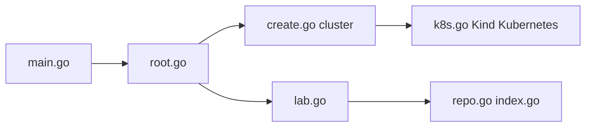

# badtuxx/girus-cli

> CLI to run hands-on Linux, Docker, Kubernetes or Terraform labs locally in a Kind cluster.

## The problem
Practicing Kubernetes or Terraform requires infrastructure or a paid cloud service (like Katacoda, Instruqt).

## What it actually does
`girus create cluster` checks Docker, installs Kind, creates a local cluster and deploys the backend (Go) and frontend (React). Labs are described in YAML (`lab.yaml`) and distributed through index-based repositories (`index.yaml`, `girus repo`, `girus lab`). The repository only contains the CLI; the backend and frontend are described but absent from the code.

## How it is wired


## Trying it
```bash
curl -sSL girus.linuxtips.io | bash
girus create cluster
girus repo add linuxtips https://github.com/linuxtips/labs/raw/main
girus lab list
girus lab install linuxtips linux-basics
```

## Cost and gotchas
Free. Docker is required; the README mentions roughly 1 to 2 GB of RAM and 5 GB of disk. The `curl | bash` install script should be reviewed before running.

## What it is not
Not an online platform or a production tool: it is local training. README in Portuguese with Spanish and Portuguese versions. GPL-3.0 license. Version 0.5.0 announced in May 2025.

## Alternatives
Katacoda and Instruqt are cited as SaaS services that Girus replaces with local execution.

## For you
Worth watching: useful for building Kubernetes or Docker skills on your own machine, of little relevance to the core of your data/AI work.
