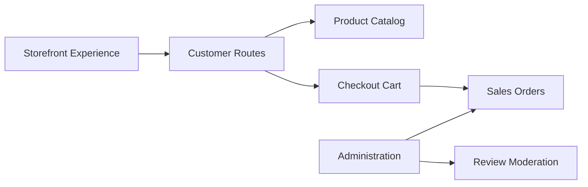

# bagisto/bagisto

> Open-source e-commerce and multi-vendor marketplace platform, built with Laravel and Vue.js.

## The problem
Launching a custom online store or marketplace takes a lot of development.

## What it actually does
Laravel store with catalog, cart, orders, stock, returns (RMA), customer reviews with attachments and moderation, social login, and optional translation via MagicAI. B2B, marketplace, multi-tenant, POS and headless (Next.js) extensions are offered. Docker images exist for several web servers and databases (MySQL, MariaDB, PostgreSQL).

## How it is wired


## Trying it
```bash
docker run -d --name bagisto -p 80:80 webkul/bagisto:latest
```

## Cost and gotchas
The core is free; extensions (200+) and managed cloud hosting are paid offerings from the vendor. The mentioned LLM integration assumes API keys at your expense.

## What it is not
Not an AI tool: the mentions of LLMs and blockchain are integration ideas, not shipped features.

## Alternatives
No alternative named in the README.

## For you
Ignore: PHP e-commerce platform, unrelated to your data / AI / MLOps needs.
