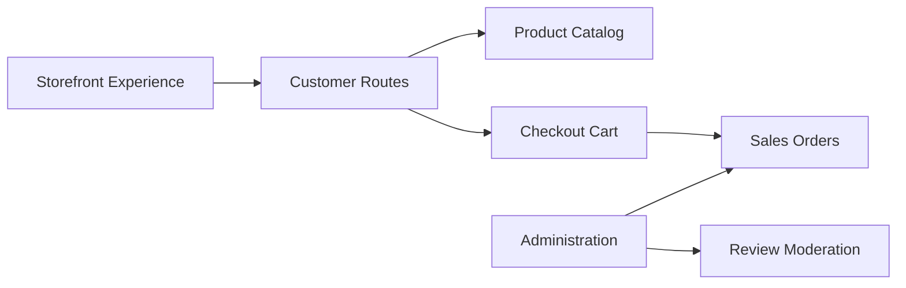

# bagisto/bagisto

> Plateforme e-commerce et marketplace multi-vendeurs open source, construite avec Laravel et Vue.js.

## Le problème
Lancer une boutique en ligne ou une marketplace sur mesure demande beaucoup de développement.

## Ce que ça fait vraiment
Boutique Laravel avec catalogue, panier, commandes, stocks, retours (RMA), avis clients avec pièces jointes et modération, connexion sociale, et traduction optionnelle via MagicAI. Des extensions B2B, marketplace, multi-tenant, POS et headless (Next.js) sont proposées. Des images Docker existent pour plusieurs serveurs web et bases (MySQL, MariaDB, PostgreSQL).

## Comment c'est branché


## Essayer
```bash
docker run -d --name bagisto -p 80:80 webkul/bagisto:latest
```

## Coût et pièges
Le cœur est gratuit ; des extensions (200+) et l'hébergement cloud géré sont des offres de l'éditeur. L'intégration LLM mentionnée suppose des clés d'API à ta charge.

## Ce que ce n'est pas
Pas un outil IA : les mentions de LLM et de blockchain sont des idées d'intégration, pas des fonctions livrées.

## Alternatives
Aucune alternative nommée dans le README.

## Pour toi
À ignorer : plateforme e-commerce PHP, sans rapport avec tes besoins data / IA / MLOps.

