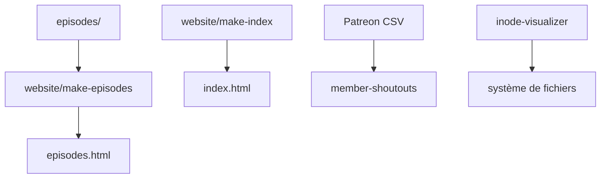

# bahamas10/ysap

> Repository of Dave Eddy's video series on programming, mostly bash scripts.

## The problem
Video episodes are more useful with the code and notes at hand.

## What it actually does
Gathers the episode scripts and notes (episodes/), the code of videos outside the series (code/), the authoring tools, the scripts that generate the ysap.sh site and programs for the Patreon shoutouts. The demos are independent: an inode visualizer in Rust, illumos doors in C, a JSON HTTP server.

## How it is wired


## Trying it
```bash
curl ysap.sh/episodes
```

## Cost and gotchas
Free. Each demo requires its own tooling (Rust, C, Node.js).

## What it is not
Not an application nor a library: it is teaching material. The catalog declares no license, while the README announces MIT.

## Alternatives
No alternative named in the README.

## For you
Ignore: unless you want to improve at bash scripting, these videos bring nothing specific to data / AI / MLOps work.
