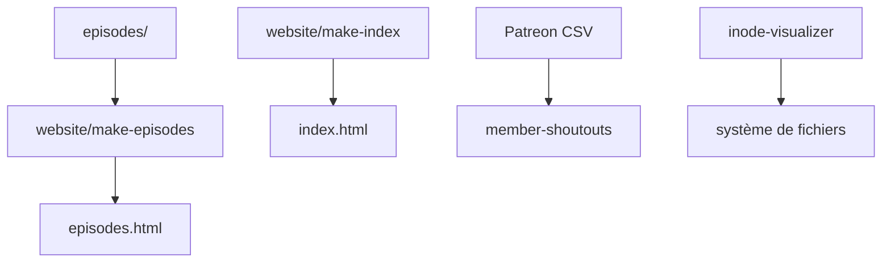

# bahamas10/ysap

> Dépôt de la série vidéo de Dave Eddy sur la programmation, surtout les scripts bash.

## Le problème
Les épisodes vidéo sont plus utiles avec le code et les notes sous la main.

## Ce que ça fait vraiment
Regroupe les scripts et notes des épisodes (episodes/), le code des vidéos hors série (code/), les outils de création, les scripts qui génèrent le site ysap.sh et des programmes pour les remerciements Patreon. Les démonstrations sont indépendantes : visualiseur d'inodes en Rust, doors illumos en C, serveur HTTP JSON.

## Comment c'est branché


## Essayer
```bash
curl ysap.sh/episodes
```

## Coût et pièges
Gratuit. Les démonstrations demandent chacune leur outillage (Rust, C, Node.js).

## Ce que ce n'est pas
Pas une application ni une bibliothèque : c'est du matériel pédagogique. Le catalogue ne déclare pas de licence, alors que le README annonce MIT.

## Alternatives
Aucune alternative nommée dans le README.

## Pour toi
Ignorer : sauf si tu veux progresser en scripts bash, ces vidéos n'apportent rien de précis à un travail data / IA / MLOps.

