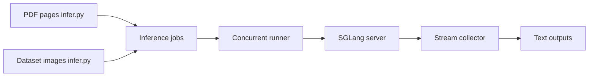

# baidu/Unlimited-OCR

> Model for analyzing long, multi-page documents and PDFs, for those doing OCR on NVIDIA GPUs.

## The problem
Classic OCR loses coherence on long documents; pages must be split and stitched back together.

## What it actually does
A model published on Hugging Face (`baidu/Unlimited-OCR`) that analyzes one image or several pages at once (`infer_multi`, 32,768-token context). Three deployment routes: Transformers, vLLM (dedicated Docker images) and SGLang. In this repository, only `infer.py` is code: it converts PDFs to images and sends concurrent streaming requests to an SGLang server. The model implementation is not in the tree.

## How it is wired


## Trying it
```bash
docker pull vllm/vllm-openai:unlimited-ocr
python infer.py --image_dir ./examples/images --output_dir ./outputs --concurrency 8 --image_mode gundam
python infer.py --pdf ./examples/document.pdf --output_dir ./outputs --concurrency 8 --image_mode gundam
```

## Cost and gotchas
NVIDIA GPU required (CUDA 12.9 or 13.0), pinned dependencies (torch 2.10.0, transformers 4.57.1), `trust_remote_code=True` for Transformers. The README also asks for a local SGLang wheel.

## What it is not
Not a ready-to-use service: the README's "Visualization" section is empty and no performance figure appears in it. No model license specified beyond that of the repository.

## Alternatives
- Deepseek-OCR: the README says it aims "one step further" than it.

## For you
Watch: interesting if you process long PDFs on GPU, but the README shows no measurement; compare it on your own documents before adopting it.
