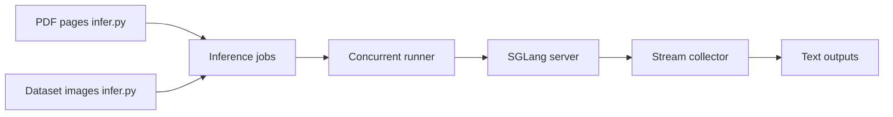

# baidu/Unlimited-OCR

> Modèle d'analyse de documents longs, multi-pages et PDF, pour qui fait de l'OCR sur GPU NVIDIA.

## Le problème
Les OCR classiques perdent la cohérence sur de longs documents ; il faut découper et recoller les pages.

## Ce que ça fait vraiment
Un modèle publié sur Hugging Face (`baidu/Unlimited-OCR`) qui analyse une image ou plusieurs pages d'un coup (`infer_multi`, contexte 32 768 tokens). Trois voies de déploiement : Transformers, vLLM (images Docker dédiées) et SGLang. Dans ce dépôt, seul `infer.py` est du code : il convertit les PDF en images et envoie des requêtes concurrentes en streaming à un serveur SGLang. L'implémentation du modèle n'est pas dans l'arbre.

## Comment c'est branché


## Essayer
```bash
docker pull vllm/vllm-openai:unlimited-ocr
python infer.py --image_dir ./examples/images --output_dir ./outputs --concurrency 8 --image_mode gundam
python infer.py --pdf ./examples/document.pdf --output_dir ./outputs --concurrency 8 --image_mode gundam
```

## Coût et pièges
GPU NVIDIA indispensable (CUDA 12.9 ou 13.0), dépendances épinglées (torch 2.10.0, transformers 4.57.1), `trust_remote_code=True` pour Transformers. Le README demande aussi un wheel SGLang local.

## Ce que ce n'est pas
Pas un service prêt à l'emploi : la section « Visualization » du README est vide et aucun chiffre de performance n'y figure. Pas de licence du modèle précisée au-delà de celle du dépôt.

## Alternatives
- Deepseek-OCR : le README dit viser « un pas de plus » que lui.

## Pour toi
À surveiller : intéressant si tu traites des PDF longs sur GPU, mais le README ne montre aucune mesure ; compare-le sur tes documents avant de l'adopter.

