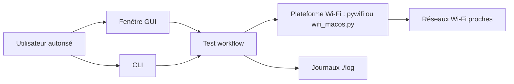

# baihengaead/wifi-crack-tool

> Python graphical application that tests candidate passwords on a Wi-Fi network, reserved for authorized audits.

## The problem
Checking that a Wi-Fi network you own, or are mandated to audit, does not use a weak password requires a dedicated testing tool.

## What it actually does
Scans nearby Wi-Fi networks then tries to connect to them with a list of passwords supplied by the user, and reports whether a candidate works. Graphical interface (PySide6) and command line. Handles WPA to WPA3 protocols, an automatic mode, use of several Wi-Fi cards in parallel, a per-SSID dictionary and logs. Windows/Linux go through pywifi, macOS through an internal `wifi_macos.py` module.

## How it is wired


## Trying it
The README documents no install or launch command; it only describes the configuration files:
```bash
# Liste de mots de passe (une ligne par candidat)
./passwords.txt
# Dictionnaire par SSID
./dict/pwdict.json
# Journaux
./log
```

## Cost and gotchas
Free (MIT). Python ≥ 3.11; Linux and macOS are announced as experimental. Multi-instance requires at least two working Wi-Fi cards; scan and connection delays must be tuned to the card.

## What it is not
A dual-use tool: the README limits use to research, teaching, written tests authorized by the owner, or your own equipment. Testing a third-party network without authorization is illegal; the README refers to Chinese law. It is neither a full audit nor a traffic analyzer.

## Alternatives
No alternative named in the README.

## For you
Worth watching only: useful for auditing your own network, but little relation to data/AI/MLOps work and the legal framework is strict.
