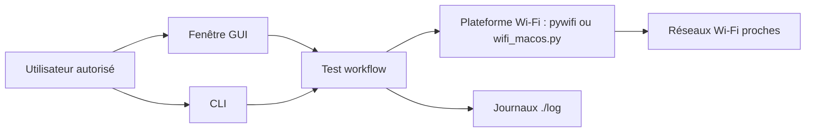

# baihengaead/wifi-crack-tool

> Application graphique Python qui teste des mots de passe candidats sur un réseau Wi-Fi, réservée aux audits autorisés.

## Le problème
Vérifier qu'un réseau Wi-Fi que l'on possède, ou que l'on est mandaté pour auditer, n'utilise pas un mot de passe faible demande un outil de test dédié.

## Ce que ça fait vraiment
Scanne les réseaux Wi-Fi proches puis tente de s'y connecter avec une liste de mots de passe fournie par l'utilisateur, et indique si un candidat fonctionne. Interface graphique (PySide6) et ligne de commande. Gère les protocoles WPA à WPA3, un mode automatique, l'usage de plusieurs cartes Wi-Fi en parallèle, un dictionnaire par SSID et des journaux. Windows/Linux passent par pywifi, macOS par un module interne `wifi_macos.py`.

## Comment c'est branché


## Essayer
Le README ne documente aucune commande d'installation ou de lancement ; il décrit seulement les fichiers de configuration :
```bash
# Liste de mots de passe (une ligne par candidat)
./passwords.txt
# Dictionnaire par SSID
./dict/pwdict.json
# Journaux
./log
```

## Coût et pièges
Gratuit (MIT). Python ≥ 3.11 ; Linux et macOS annoncés comme expérimentaux. Le multi-instance exige au moins deux cartes Wi-Fi fonctionnelles ; les délais de scan et de connexion sont à régler selon la carte.

## Ce que ce n'est pas
Un outil à double usage : le README limite l'emploi à la recherche, à l'enseignement, aux tests écrits autorisés par le propriétaire, ou à ses propres équipements. Tester un réseau tiers sans autorisation est illégal ; le README renvoie au droit chinois. Il n'est ni un audit complet ni un analyseur de trafic.

## Alternatives
Aucune alternative nommée dans le README.

## Pour toi
À surveiller seulement : utile pour auditer son propre réseau, mais peu de rapport avec un travail data/IA/MLOps et le cadre légal est strict.

