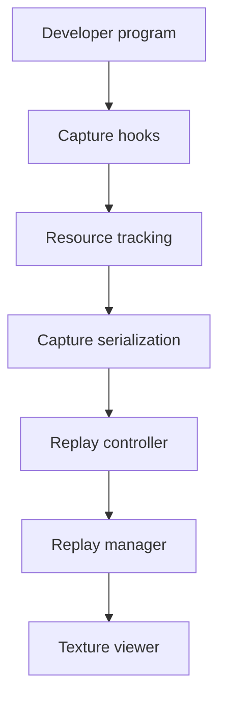

# baldurk/renderdoc

> Frame-capture graphics debugger, for developers inspecting their own Vulkan, Direct3D or OpenGL rendering.

## The problem
When a 3D render is wrong, nothing shows the GPU state frame by frame: textures, pipeline stages, draw calls.

## What it actually does
It captures a frame rendered by your program, then replays it in a desktop interface. You see the calls, textures and pipeline stages. It covers Vulkan, D3D11, D3D12, OpenGL and OpenGL ES, on Windows, Linux and Android. A Python API lets you script the analysis.

## How it is wired


## Trying it
```bash
# Pas de commande documentée pour l'usage :
# lancer l'installateur ou le zip portable téléchargé sur https://renderdoc.org/builds
# Compilation : voir Compiling.md
```

## Cost and gotchas
Free, MIT license. Use is limited to your own programs: the README forbids any discussion about capturing software you did not create. Linux: x86 64-bit only.

## What it is not
Not an AI model profiling tool: it is for graphics APIs. Metal is not supported.

## Alternatives
No alternative named in the README.

## For you
Ignore: it targets 3D rendering debugging, far from data, AI or MLOps needs, except for graphics work.
