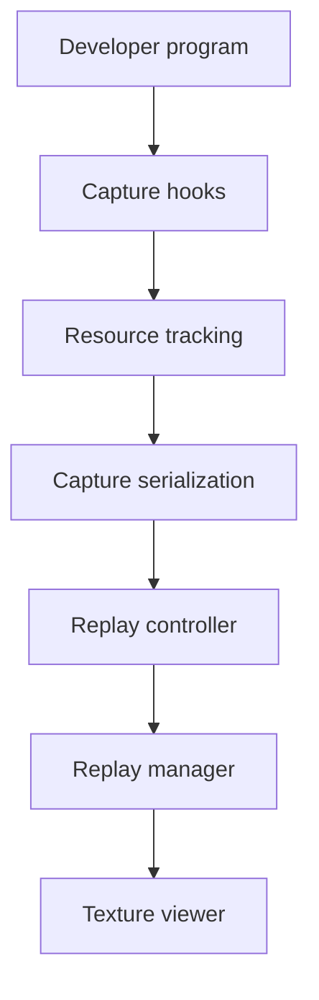

# baldurk/renderdoc

> Débogueur graphique par capture d'image, pour développeurs qui inspectent leurs propres rendus Vulkan, Direct3D ou OpenGL.

## Le problème
Quand un rendu 3D est faux, rien ne montre l'état du GPU image par image : textures, étapes du pipeline, appels de dessin.

## Ce que ça fait vraiment
Il capture une image rendue par ton programme, puis la rejoue dans une interface de bureau. Tu y vois les appels, les textures et les étapes du pipeline. Il couvre Vulkan, D3D11, D3D12, OpenGL et OpenGL ES, sur Windows, Linux et Android. Une API Python permet de scripter l'analyse.

## Comment c'est branché


## Essayer
```bash
# Pas de commande documentée pour l'usage :
# lancer l'installateur ou le zip portable téléchargé sur https://renderdoc.org/builds
# Compilation : voir Compiling.md
```

## Coût et pièges
Gratuit, licence MIT. Usage réservé à tes propres programmes : le README interdit toute discussion sur la capture de logiciels que tu n'as pas créés. Linux : x86 64 bits uniquement.

## Ce que ce n'est pas
Ce n'est pas un outil de profilage de modèles d'IA : il sert aux APIs graphiques. Metal n'est pas pris en charge.

## Alternatives
Aucune alternative nommée dans le README.

## Pour toi
Ignorer : il vise le débogage de rendu 3D, loin des besoins data, IA ou MLOps, sauf pour du travail graphique.

