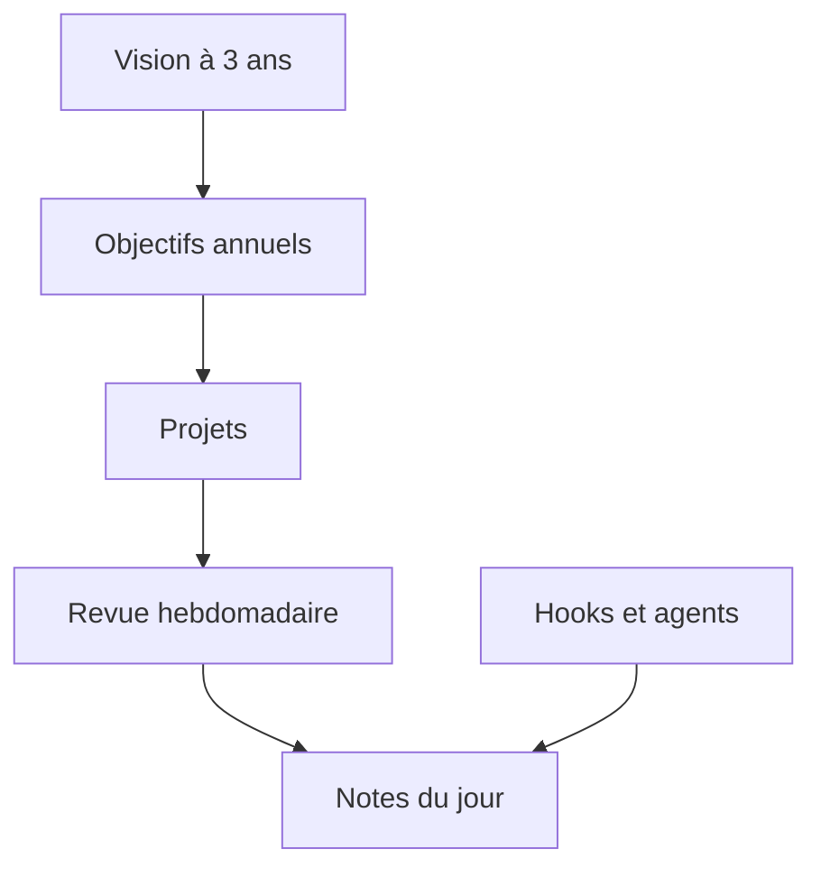

# ballred/obsidian-claude-pkm

> An Obsidian vault driven by Claude Code, linking three-year goals to daily tasks.

## The problem
Goals, projects, reviews and daily notes live in separate files that don't talk to each other, and nothing checks alignment.

## What it actually does
A vault template with 10 skills (`/daily`, `/weekly`, `/monthly`, `/project`, `/review`, `/adopt`, `/upgrade`...), 4 agents with project memory and a "coach" output style. Bash hooks commit every write and display the week's top task. Everything runs on bash and markdown, with no dependencies.

## How it is wired
Simplified diagram based on the card, no diagram provided.



## Trying it
```bash
git clone https://github.com/ballred/obsidian-claude-pkm.git
cd obsidian-claude-pkm
chmod +x scripts/setup.sh && ./scripts/setup.sh
claude
```

## Cost and gotchas
Free (MIT), but you need Claude Code with its subscription or API calls at your own expense. The automatic commit hook creates a commit on every write.

## What it is not
Not an Obsidian application: it is a `.claude/` configuration dropped into a vault. No Obsidian plugin and no interface of its own.

## Alternatives
No alternative named in the README.

## For you
Worth watching: useful as an example of well-structured Claude Code skills, agents and hooks, to borrow from rather than adopt wholesale.
