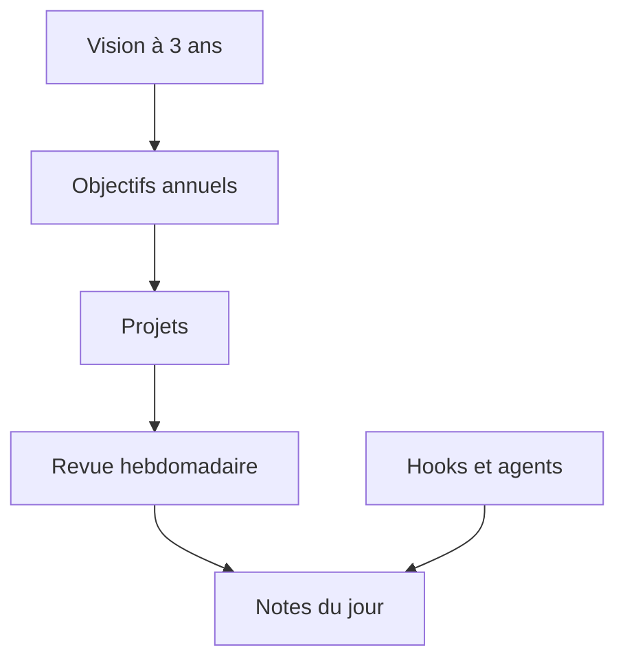

# ballred/obsidian-claude-pkm

> Un coffre Obsidian piloté par Claude Code, qui relie objectifs à trois ans et tâches quotidiennes.

## Le problème
Les objectifs, projets, revues et notes du jour vivent dans des fichiers séparés qui ne se parlent pas, et rien ne vérifie l'alignement.

## Ce que ça fait vraiment
Un modèle de coffre avec 10 skills (`/daily`, `/weekly`, `/monthly`, `/project`, `/review`, `/adopt`, `/upgrade`…), 4 agents à mémoire de projet et un style de sortie « coach ». Des hooks bash commitent chaque écriture et affichent la tâche principale de la semaine. Tout tourne en bash et markdown, sans dépendance.

## Comment c'est branché
Schéma simplifié d'après la fiche, sans diagramme fourni.



## Essayer
```bash
git clone https://github.com/ballred/obsidian-claude-pkm.git
cd obsidian-claude-pkm
chmod +x scripts/setup.sh && ./scripts/setup.sh
claude
```

## Coût et pièges
Gratuit (MIT), mais il faut Claude Code avec son abonnement ou ses appels à ta charge. Le hook de commit automatique crée un commit à chaque écriture.

## Ce que ce n'est pas
Pas une application Obsidian : c'est une configuration `.claude/` posée dans un coffre. Pas de plugin Obsidian ni d'interface propre.

## Alternatives
Aucune alternative nommée dans le README.

## Pour toi
À surveiller : utile comme exemple de skills, agents et hooks Claude Code bien structurés, à piller plutôt qu'à adopter en bloc.

