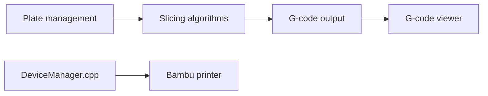

# bambulab/BambuStudio

> Slicing software for Bambu Lab 3D printers, for makers.

## The problem
Preparing 3D models into optimized G-code, with plate management and printer control.

## What it actually does
Slicing, G-code viewer, multiple plates, automatic orientation and placement, supports (tree, hybrid), multi-material, painting, STEP format, advanced cooling, exploded view, remote control. Derived from PrusaSlicer and Slic3r.

## How it is wired

## Trying it
The README provides Windows, macOS and Linux binaries on the releases page and build guides; no command appears in it.

## Cost and gotchas
Free. 8,098 open issues. Linux: AppImage or Flathub.

## What it is not
Not a 3D modeling tool: it is slicing software for 3D printers, which prepares existing models without creating them.

## Alternatives
No alternative cited in the README (PrusaSlicer mentioned as a base).

## For you
Ignore: 3D printing, unrelated to data / AI / MLOps.
