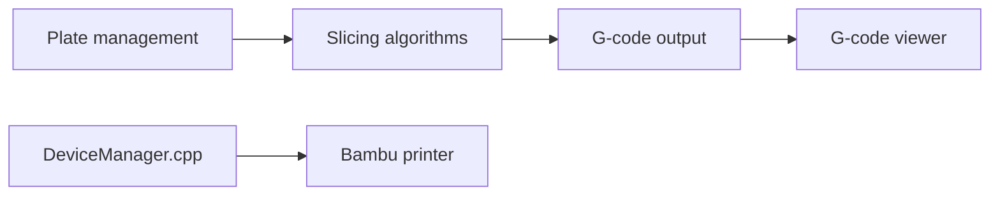

# bambulab/BambuStudio

> Logiciel de tranchage pour imprimantes 3D Bambu Lab, pour makers.

## Le problème
Préparer des modèles 3D en G-code optimisé avec gestion de plateaux et contrôle d'imprimante.

## Ce que ça fait vraiment
Tranchage, visionneuse G-code, plusieurs plateaux, orientation et placement automatiques, supports (arbre, hybride), multi-matériaux, peinture, format STEP, refroidissement avancé, vue éclatée, contrôle à distance. Dérivé de PrusaSlicer et Slic3r.

## Comment c'est branché

## Essayer
Le README fournit des binaires Windows, macOS et Linux sur la page des releases et des guides de compilation ; aucune commande n'y figure.

## Coût et pièges
Gratuit. 8 098 issues ouvertes. Linux : AppImage ou Flathub.

## Ce que ce n'est pas
Pas un outil de modélisation 3D.

## Alternatives
Aucune alternative citée dans le README (PrusaSlicer mentionné comme base).

## Pour toi
À ignorer : impression 3D, sans lien avec data / IA / MLOps.

