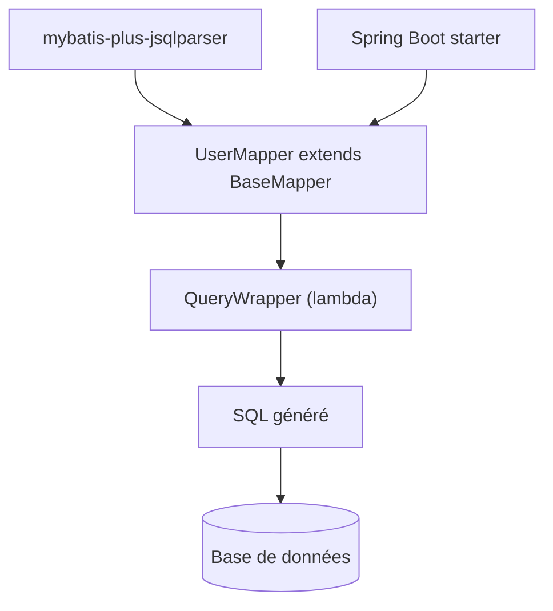

# baomidou/mybatis-plus

> Java layer on top of MyBatis that simplifies database access in Spring Boot applications.

## The problem
Hand-writing CRUD queries, pagination and MyBatis mappers is repetitive.

## What it actually does
Provides a `BaseMapper` interface, a condition builder (`QueryWrapper`, lambda style), several primary-key strategies, a code generator, automatic pagination and SQL injection defense. Starters for Spring Boot 2, 3 and 4; SQL parser modules (JSqlParser) to choose depending on the JDK.

## How it is wired


## Trying it
```xml
<dependency>
    <groupId>com.baomidou</groupId>
    <artifactId>mybatis-plus-spring-boot3-starter</artifactId>
    <version>Latest Version</version>
</dependency>
```

## Cost and gotchas
Free. Since 3.5.9, a SQL parser module is required for pagination. A "Mybatis-Mate" edition is mentioned as an enterprise version (advanced features).

## What it is not
Not a standalone ORM: it depends on MyBatis. The README is partly in Chinese and points to a WeChat group.

## Alternatives
No alternative is named in the README.

## For you
Ignore: Java/Spring ecosystem unrelated to a data, AI or MLOps profile.
