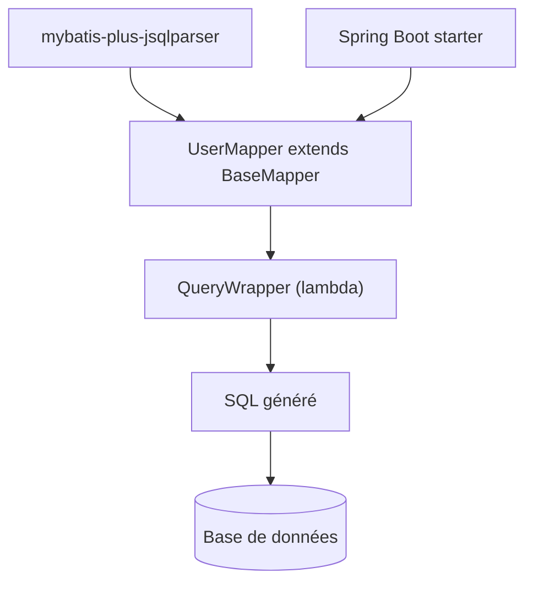

# baomidou/mybatis-plus

> Surcouche Java de MyBatis qui simplifie l'accès aux bases de données dans les applications Spring Boot.

## Le problème
Écrire à la main les requêtes CRUD, la pagination et les mappers MyBatis est répétitif.

## Ce que ça fait vraiment
Fournit une interface `BaseMapper`, un constructeur de conditions (`QueryWrapper`, style lambda), plusieurs stratégies de clé primaire, un générateur de code, la pagination automatique et une défense contre l'injection SQL. Starters pour Spring Boot 2, 3 et 4 ; modules de parseur SQL (JSqlParser) à choisir selon le JDK.

## Comment c'est branché


## Essayer
```xml
<dependency>
    <groupId>com.baomidou</groupId>
    <artifactId>mybatis-plus-spring-boot3-starter</artifactId>
    <version>Latest Version</version>
</dependency>
```

## Coût et pièges
Gratuit. Depuis la 3.5.9, un module de parseur SQL est requis pour la pagination. Une édition « Mybatis-Mate » est mentionnée comme version entreprise (fonctions avancées).

## Ce que ce n'est pas
Pas un ORM autonome : il dépend de MyBatis. Le README est en partie en chinois et renvoie à un groupe WeChat.

## Alternatives
Aucune alternative nommée dans le README.

## Pour toi
Ignorer : écosystème Java/Spring sans lien avec un profil data, IA ou MLOps.

