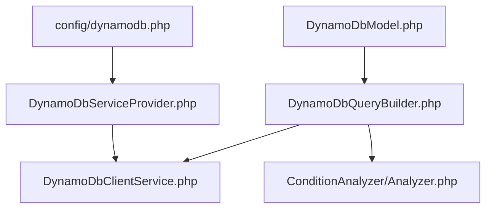

# baopham/laravel-dynamodb

> Eloquent-style model for Laravel that reads from and writes to Amazon DynamoDB.

## The problem
Using DynamoDB from Laravel forces you to handle the AWS SDK and its low-level expressions.

## What it actually does
A model extends `DynamoDbModel`, and the query builder analyzes conditions to choose Query or Scan, depending on the declared keys and indexes. Parsers produce the DynamoDB expressions, sent by the configured AWS client. Asynchronous writes go through Guzzle promises.

## How it is wired


## Trying it
```bash
composer require baopham/dynamodb
php artisan vendor:publish --provider 'BaoPham\DynamoDb\DynamoDbServiceProvider'
```

## Cost and gotchas
DynamoDB is billed by AWS. PHP and Laravel are required but absent from the prerequisites list. `all()` does a scan limited to 1 MB; no offset, pagination by last item; the README mentions Laravel ^5.1 and is aimed at advanced users.

## What it is not
Not a full ORM: DynamoDB has no joins or auto-increment identifiers, you need UUIDs.

## Alternatives
No alternative named in the README.

## For you
Ignore: useful only for a Laravel app on DynamoDB, outside the data/AI/MLOps scope.
