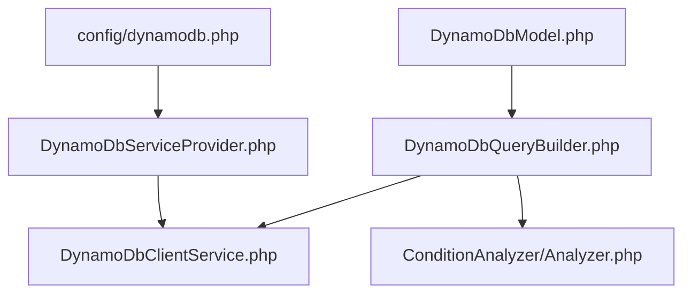

# baopham/laravel-dynamodb

> Modèle de type Eloquent pour Laravel qui lit et écrit dans Amazon DynamoDB.

## Le problème
Utiliser DynamoDB depuis Laravel oblige à manier le SDK AWS et ses expressions à bas niveau.

## Ce que ça fait vraiment
Un modèle étend `DynamoDbModel`, et le constructeur de requêtes analyse les conditions pour choisir Query ou Scan, selon les clés et index déclarés. Des parseurs produisent les expressions DynamoDB, envoyées par le client AWS configuré. Les écritures asynchrones passent par des promesses Guzzle.

## Comment c'est branché


## Essayer
```bash
composer require baopham/dynamodb
php artisan vendor:publish --provider 'BaoPham\DynamoDb\DynamoDbServiceProvider'
```

## Coût et pièges
DynamoDB est facturé par AWS. PHP et Laravel sont requis mais absents de la liste de prérequis. `all()` fait un scan limité à 1 Mo ; pas d'offset, pagination par dernier élément ; le README mentionne Laravel ^5.1 et s'adresse aux utilisateurs avertis.

## Ce que ce n'est pas
Pas un ORM complet : DynamoDB n'a ni jointures ni identifiants auto-incrémentés, il faut des UUID.

## Alternatives
Aucune alternative nommée dans le README.

## Pour toi
À ignorer : utile seulement pour une appli Laravel sur DynamoDB, hors du périmètre data/IA/MLOps.

