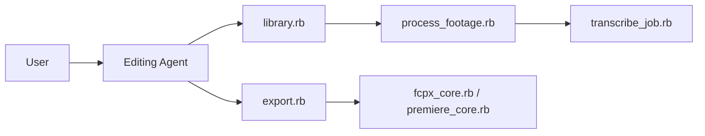

# barefootford/buttercut

> XML generator and video-editing agent driven by Claude Code, targeting Final Cut, Premiere and Resolve.

## The problem
Sorting through and editing hours of raw footage by hand is slow; an agent has no clean interchange format to editing software.

## What it actually does
Organizes footage into libraries, transcribes it (WhisperX), produces contact sheets and transcripts, then the agent builds a selection or a rough cut with you. XML export to Final Cut Pro, Premiere and DaVinci Resolve. Installation is done through the `/setup` skill.

## How it is wired


## Trying it
```bash
git clone https://github.com/barefootford/buttercut.git && cd buttercut
```
Then call the `/setup` skill in Claude Code.

## Cost and gotchas
Core version is free; Pro is $49/year (multi-track, preview). Targets Apple Silicon Macs; Ruby, Python, FFmpeg and WhisperX required. Copyright assignment to TubeSalt LLC for any PR.

## What it is not
Not officially cross-platform. Not a video editor: it generates XML projects. License present but not identified by GitHub.

## Alternatives
No alternative named in the README.

## For you
Worth watching: an original use case of an agent applied to a trade, but the license is unclear and the Pro version is paid.
