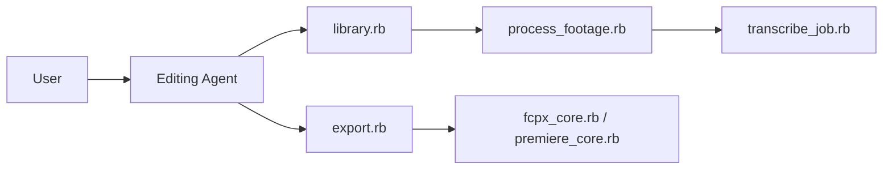

# barefootford/buttercut

> Générateur XML et agent de montage vidéo pilotés par Claude Code, vers Final Cut, Premiere et Resolve.

## Le problème
Dérusher et monter des heures de rushes à la main est long ; un agent n'a pas de format d'échange propre vers les logiciels de montage.

## Ce que ça fait vraiment
Organise les rushes en bibliothèques, les transcrit (WhisperX), produit planches-contacts et transcriptions, puis l'agent construit une sélection ou un premier montage avec toi. Export XML vers Final Cut Pro, Premiere et DaVinci Resolve. L'installation se fait par le skill `/setup`.

## Comment c'est branché


## Essayer
```bash
git clone https://github.com/barefootford/buttercut.git && cd buttercut
```
Puis appeler le skill `/setup` dans Claude Code.

## Coût et pièges
Version cœur gratuite ; Pro à 49 $/an (multi-pistes, aperçu). Cible les Mac Apple Silicon ; Ruby, Python, FFmpeg et WhisperX requis. Cession du copyright à TubeSalt LLC pour toute PR.

## Ce que ce n'est pas
Pas multi-plateforme officiel. Pas un éditeur vidéo : il génère des projets XML. Licence présente mais non identifiée par GitHub.

## Alternatives
Aucune alternative nommée dans le README.

## Pour toi
À surveiller : cas d'usage original d'agent sur un métier, mais licence floue et version Pro payante.

