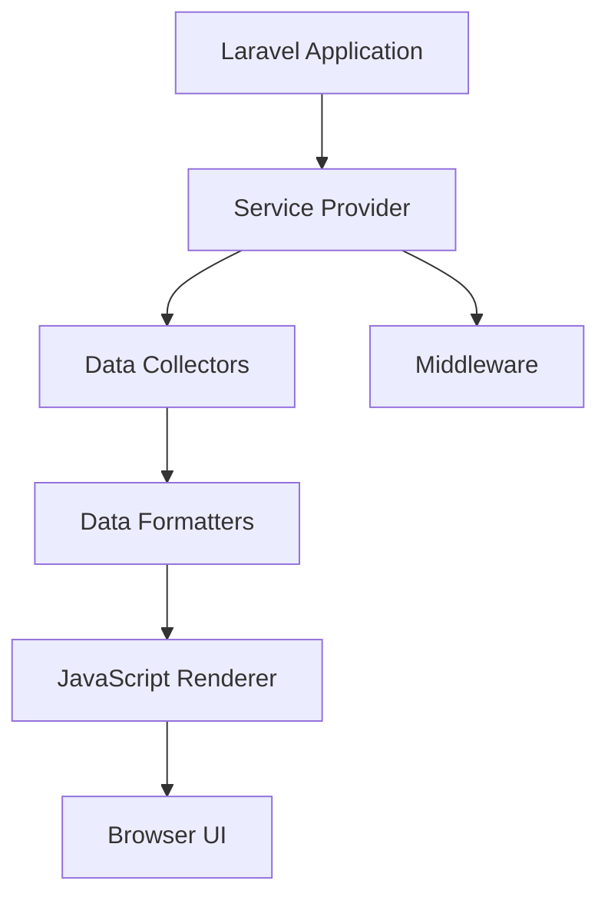

# barryvdh/laravel-debugbar

> Debug bar for Laravel applications: SQL queries, routes, views, events and timing.

## The problem
Understanding what slows down or breaks a Laravel request during development.

## What it actually does
A service provider adds a bar at the bottom of the page with collectors (queries with bindings and duration, routes, views, events, logs, memory, exceptions). A `Debugbar` facade to log messages and measure durations. Twig, Livewire and Octane integration.

## How it is wired


## Trying it
```shell
composer require fruitcake/laravel-debugbar --dev
php artisan vendor:publish --provider='Fruitcake\LaravelDebugbar\ServiceProvider'
```

## Cost and gotchas
Free. Actually requires PHP, Composer and Laravel (not on your list). The package has been renamed fruitcake/laravel-debugbar. Never expose it in production: it leaks stored queries.

## What it is not
Not a production profiling or observability tool: the author advises against it on public sites.

## Alternatives
Clockwork, built in as an option according to the architecture.

## For you
Ignore: Laravel-specific, unrelated to your data and MLOps work.
