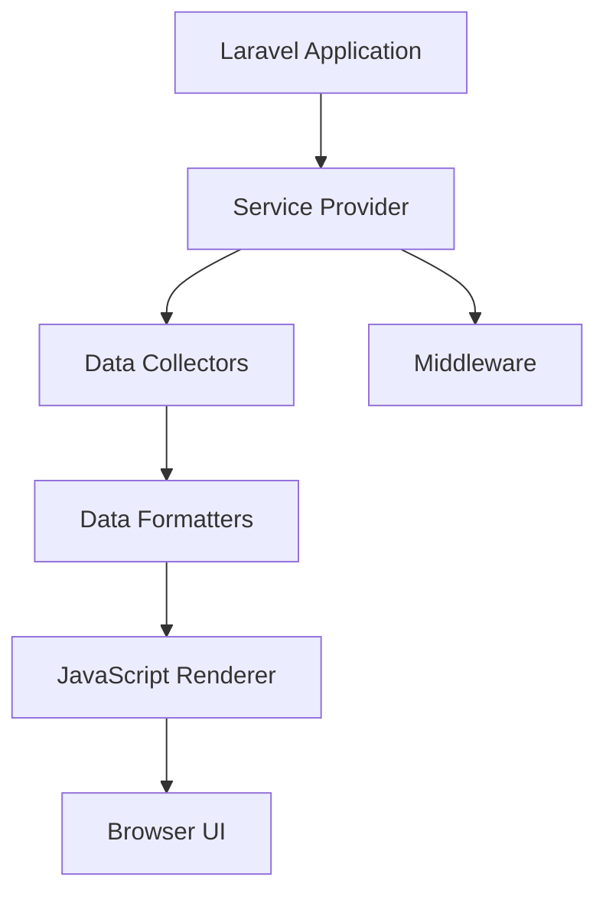

# barryvdh/laravel-debugbar

> Barre de débogage pour applications Laravel : requêtes SQL, routes, vues, événements et temps.

## Le problème
Comprendre ce qui ralentit ou casse une requête Laravel en développement.

## Ce que ça fait vraiment
Un fournisseur de services ajoute une barre en bas de page avec des collecteurs (requêtes avec bindings et durée, routes, vues, événements, logs, mémoire, exceptions). Façade `Debugbar` pour journaliser des messages et mesurer des durées. Intégration Twig, Livewire, Octane.

## Comment c'est branché


## Essayer
```shell
composer require fruitcake/laravel-debugbar --dev
php artisan vendor:publish --provider='Fruitcake\LaravelDebugbar\ServiceProvider'
```

## Coût et pièges
Gratuit. Besoin réel de PHP, Composer et Laravel (hors liste). Le paquet a été renommé fruitcake/laravel-debugbar. À ne jamais exposer en production : il fuit les requêtes stockées.

## Ce que ce n'est pas
Ce n'est pas un outil de profilage en production ni d'observabilité : l'auteur le déconseille sur des sites publics.

## Alternatives
Clockwork, intégré en option d'après l'architecture.

## Pour toi
À ignorer : spécifique à Laravel, sans lien avec ton travail data et MLOps.

