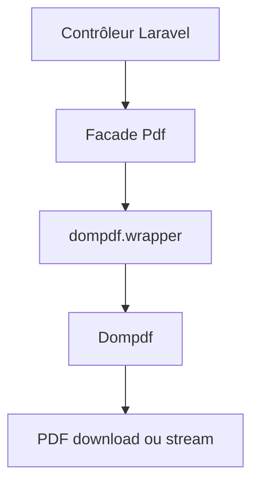

# barryvdh/laravel-dompdf

> Laravel wrapper around Dompdf to generate PDFs from HTML or Blade views.

## The problem
Producing a PDF from a Laravel app (invoices, reports) requires integrating and configuring Dompdf yourself.

## What it actually does
Provides a `Pdf` facade to load HTML, a file or a view, then save, display or download the PDF. Paper, orientation, DPI and font options, with a config publishable via `vendor:publish`. Supports PDF/A-3b with embedded XML files (Zugferd / Factur-X). Since 3.x, remote access is disabled by default.

## How it is wired
Simplified diagram based on the sheet, no diagram provided.



## Trying it
```bash
composer require barryvdh/laravel-dompdf
php artisan vendor:publish --provider="Barryvdh\DomPDF\ServiceProvider"
```
```php
$pdf = Pdf::loadView('pdf.invoice', $data);
return $pdf->download('invoice.pdf');
```

## Cost and gotchas
Free. Real need: PHP and Composer, which are missing from the prerequisites list. Keep `isRemoteEnabled` set to false for security.

## What it is not
Not a browser rendering engine: it is Dompdf, with whatever CSS it can handle. Not a tool for use outside Laravel or Lumen.

## Alternatives
No alternative named in the README.

## For you
Ignore: without a Laravel app, this package is useless to you in a data / AI / MLOps context.
