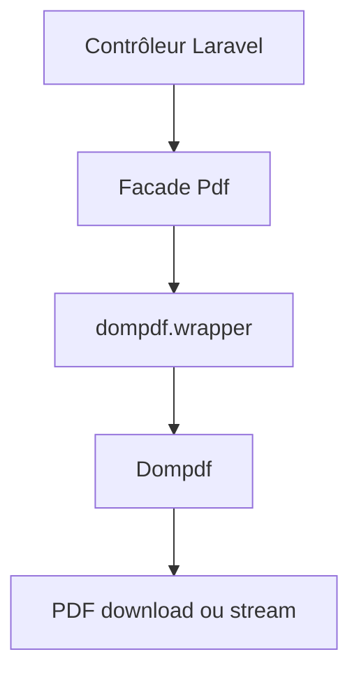

# barryvdh/laravel-dompdf

> Enveloppe Laravel autour de Dompdf pour générer des PDF à partir de HTML ou de vues Blade.

## Le problème
Produire un PDF depuis une appli Laravel (factures, rapports) demande d'intégrer et configurer Dompdf soi-même.

## Ce que ça fait vraiment
Fournit une facade `Pdf` pour charger du HTML, un fichier ou une vue, puis sauvegarder, afficher ou télécharger le PDF. Options de papier, orientation, DPI, polices, config publiable via `vendor:publish`. Prend en charge PDF/A-3b avec fichiers XML embarqués (Zugferd / Factur-X). Depuis la 3.x l'accès distant est désactivé par défaut.

## Comment c'est branché
Schéma simplifié d'après la fiche, sans diagramme fourni.



## Essayer
```bash
composer require barryvdh/laravel-dompdf
php artisan vendor:publish --provider="Barryvdh\DomPDF\ServiceProvider"
```
```php
$pdf = Pdf::loadView('pdf.invoice', $data);
return $pdf->download('invoice.pdf');
```

## Coût et pièges
Gratuit. Besoin réel : PHP et Composer, absents de la liste des prérequis. Garder `isRemoteEnabled` à false pour la sécurité.

## Ce que ce n'est pas
Pas un moteur de rendu de navigateur : c'est Dompdf, avec le CSS qu'il sait traiter. Pas un outil hors Laravel ou Lumen.

## Alternatives
Aucune alternative nommée dans le README.

## Pour toi
À ignorer : sans appli Laravel, ce paquet ne te sert à rien dans un contexte data / IA / MLOps.

