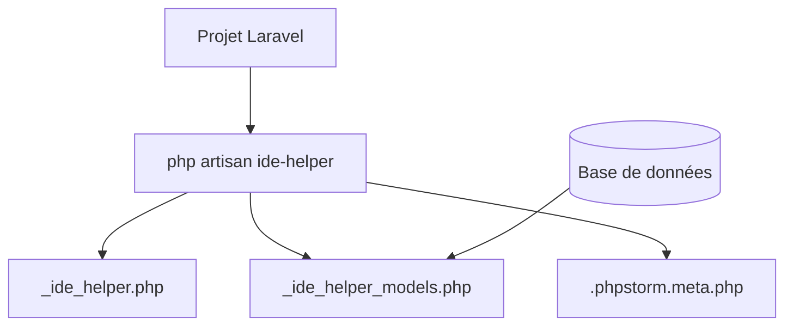

# barryvdh/laravel-ide-helper

> Laravel package that generates helper files for PHPDoc autocompletion in the editor.

## The problem
Laravel facades, Eloquent models and magic methods are not visible to the IDE, which therefore does not offer accurate autocompletion.

## What it actually does
Generates `_ide_helper.php` for facades, PHPDocs for models from columns, relations and accessors (requires a database connection), a PhpStorm meta file for the container, and helpers for fluent methods. 3.x branches for Laravel 10 and above.

## How it is wired
Simplified diagram based on the sheet, no diagram provided.


## Trying it
```bash
composer require --dev barryvdh/laravel-ide-helper
php artisan ide-helper:generate
php artisan ide-helper:models -RW
php artisan ide-helper:meta
```

## Cost and gotchas
Free. PHP, Composer and Laravel required (PHP missing from the prerequisites list). The `-W` option writes directly into the models: back up first. `-R` also replaces existing comments.

## What it is not
Not a runtime tool: it adds no function to the application, only editor help. It is meant for development only (`--dev`).

## Alternatives
No alternative named in the README.

## For you
Ignore: it only serves PHP/Laravel projects, unrelated to data / AI / MLOps work.
