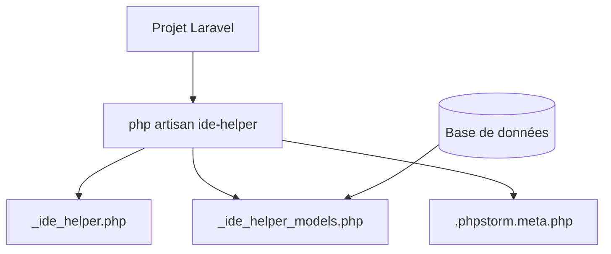

# barryvdh/laravel-ide-helper

> Paquet Laravel qui génère des fichiers d'aide pour l'autocomplétion PHPDoc dans l'éditeur.

## Le problème
Les façades, modèles Eloquent et méthodes magiques de Laravel ne sont pas visibles par l'IDE, qui n'offre donc pas d'autocomplétion exacte.

## Ce que ça fait vraiment
Génère `_ide_helper.php` pour les façades, des PHPDocs pour les modèles à partir des colonnes, relations et accesseurs (nécessite une connexion à la base), un fichier meta PhpStorm pour le conteneur, et des aides pour les méthodes fluent. Branches 3.x pour Laravel 10 et plus.

## Comment c'est branché
Schéma simplifié d'après la fiche, sans diagramme fourni.


## Essayer
```bash
composer require --dev barryvdh/laravel-ide-helper
php artisan ide-helper:generate
php artisan ide-helper:models -RW
php artisan ide-helper:meta
```

## Coût et pièges
Gratuit. PHP, Composer et Laravel requis (PHP absent de la liste des prérequis). L'option `-W` écrit directement dans les modèles : sauvegarder avant. `-R` remplace aussi les commentaires existants.

## Ce que ce n'est pas
Ce n'est pas un outil d'exécution : il n'ajoute aucune fonction à l'application, seulement de l'aide à l'éditeur. Il se réserve au développement (`--dev`).

## Alternatives
Aucune alternative nommée dans le README.

## Pour toi
À ignorer : il ne sert qu'aux projets PHP/Laravel, sans lien avec le travail data / IA / MLOps.

