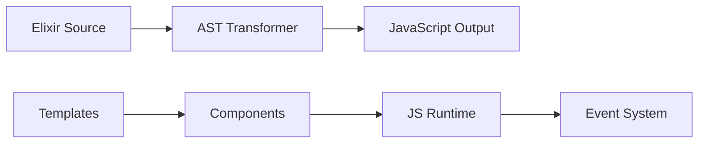

# bartblast/hologram

> Full-stack web framework in Elixir whose client code runs as Elixir in the browser.

## The problem
Writing an interactive web interface without writing JavaScript.

## What it actually does
Rebuilds the Elixir runtime in the browser; pages declare route, layout, state and actions (`action(:increment, …)`) that run client-side without a server round trip. The generated architecture mentions an Elixir-to-JavaScript compiler, router, `~HOLO` templates and sockets, but without reading the code (unverified). The README points to the documentation for installation.

## How it is wired


## Trying it
```elixir
defmodule MyApp.CounterPage do
  use Hologram.Page
  route "/counter"
  layout MyApp.MainLayout
end
```

## Cost and gotchas
Free. The project lives on sponsors and remains dependent on a main author.

## What it is not
Not a JavaScript framework nor a data tool. No mention of maturity in the README.

## Alternatives
No alternative named in the README.

## For you
Ignore: Elixir web framework, useful only if you write interfaces in Elixir, which is rare in data/AI.
