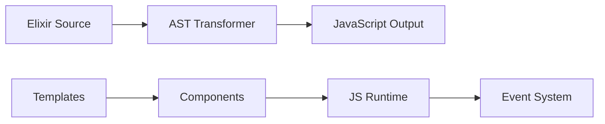

# bartblast/hologram

> Framework web full-stack en Elixir dont le code client s'exécute en Elixir dans le navigateur.

## Le problème
Écrire une interface web interactive sans écrire de JavaScript.

## Ce que ça fait vraiment
Reconstruit le runtime Elixir dans le navigateur ; les pages déclarent route, layout, état et actions (`action(:increment, …)`) qui s'exécutent côté client sans aller-retour serveur. L'architecture générée parle d'un compilateur Elixir vers JavaScript, de routeur, templates `~HOLO` et sockets, mais sans lecture du code (non vérifiée). Le README renvoie à la documentation pour l'installation.

## Comment c'est branché


## Essayer
```elixir
defmodule MyApp.CounterPage do
  use Hologram.Page
  route "/counter"
  layout MyApp.MainLayout
end
```

## Coût et pièges
Gratuit. Le projet vit de sponsors et reste dépendant d'un auteur principal.

## Ce que ce n'est pas
Pas un framework JavaScript ni un outil data. Pas de mention de maturité dans le README.

## Alternatives
Aucune alternative nommée dans le README.

## Pour toi
À ignorer : framework Elixir pour le web, utile seulement si tu écris des interfaces en Elixir, ce qui est rare en data/IA.

