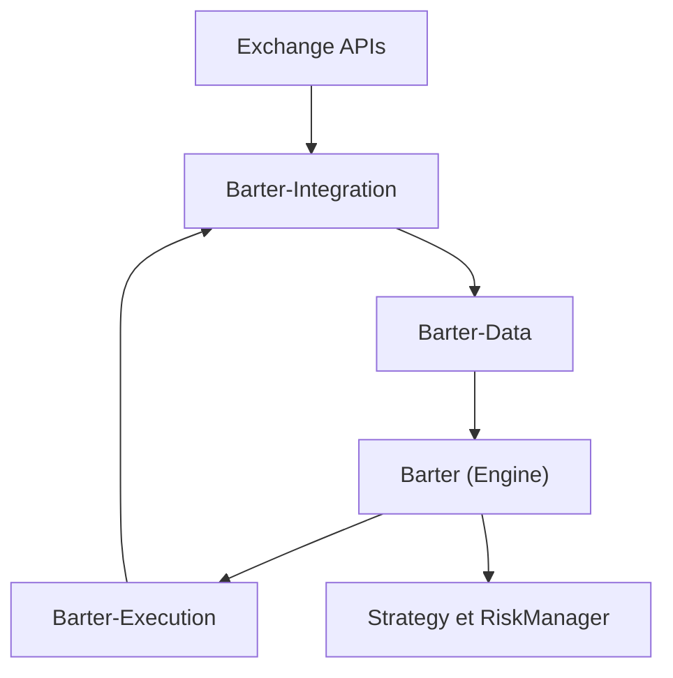

# barter-rs/barter-rs

> Set of Rust libraries for building live, paper and backtest trading systems.

## The problem
Writing a trading engine requires wiring together market streams, order execution, state management and statistics.

## What it actually does
Five crates: Barter (engine and state), Barter-Instrument, Barter-Data (public streams), Barter-Execution (orders and account) and Barter-Integration (REST and WebSocket). The Strategy and RiskManager components are replaceable; simulated streams or executions let you replay a backtest close to live. A performance summary comes out (PnL, Sharpe, Sortino, drawdown). The README states an educational purpose, not intended for real trading.

## How it is wired

## Trying it
No command documented in the README: it points to the examples in the barter/examples folder and to the docs.rs documentation.

## Cost and gotchas
Free, but building requires Rust. Real trading goes through exchange accounts and keys at your own expense. The README's legal disclaimer rules out any production use or financial advice.

## What it is not
It is not a winning strategy or a certified product. It is not a performance guarantee: simulated results have biases.

## Alternatives
No alternative named in the README.

## For you
Worth watching: interesting for studying a backtest architecture in Rust, but its educational status and single maintainer keep you from committing money to it.
