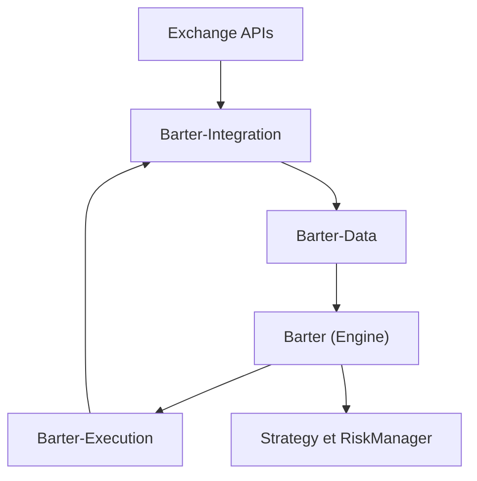

# barter-rs/barter-rs

> Ensemble de bibliothèques Rust pour construire des systèmes de trading en direct, en simulation et en backtest.

## Le problème
Écrire un moteur de trading demande de relier flux de marché, exécution d'ordres, gestion d'état et statistiques.

## Ce que ça fait vraiment
Cinq crates : Barter (moteur et état), Barter-Instrument, Barter-Data (flux publics), Barter-Execution (ordres et compte) et Barter-Integration (REST et WebSocket). Les composants Strategy et RiskManager sont remplaçables ; des flux ou exécutions simulés permettent de rejouer un backtest proche du direct. Un résumé de performance sort (PnL, Sharpe, Sortino, drawdown). Le README précise un usage éducatif, non prévu pour le trading réel.

## Comment c'est branché

## Essayer
Aucune commande documentée dans le README : il renvoie aux exemples du dossier barter/examples et à la documentation docs.rs.

## Coût et pièges
Gratuit, mais la compilation demande Rust. Le trading réel passe par des comptes de bourses et des clés à ta charge. L'avertissement juridique du README exclut tout usage en production ou conseil financier.

## Ce que ce n'est pas
Ce n'est pas une stratégie gagnante ni un produit certifié. Ce n'est pas une garantie de performance : les résultats simulés ont des biais.

## Alternatives
Aucune alternative nommée dans le README.

## Pour toi
À surveiller : intéressant pour étudier une architecture de backtest en Rust, mais son statut éducatif et son mainteneur unique empêchent d'y engager de l'argent.

