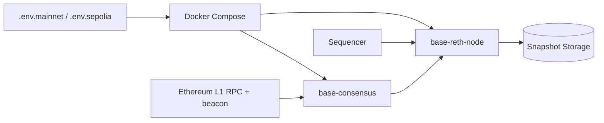

# base/node

> Docker containers, now archived, to run a node of the Base Ethereum L2.

## The problem
Operating your own Base (OP Stack) node rather than depending on a third-party RPC provider.

## What it actually does
A `docker compose` launches `base-reth-node` (execution) and `base-consensus`, configured by `.env.mainnet` or `.env.sepolia`. The node syncs from an Ethereum L1 RPC and a beacon endpoint that you provide.
Options: Flashblocks mode (`RETH_FB_WEBSOCKET_URL`), follow mode, pruning (`RETH_PRUNING_ARGS`); snapshots to speed up synchronization.
The architecture analysis provided describes an earlier version (geth, reth, nethermind clients, supervisord) that no longer matches the README.

## How it is wired


## Trying it
```bash
docker compose up --build
NETWORK_ENV=.env.sepolia docker compose up --build
```

## Cost and gotchas
32 GB of RAM minimum (64 recommended), NVMe SSD, storage of twice the chain plus the snapshot; a full L1 node to provide.

## What it is not
No longer maintained: repository archived, development moved to `base/base`. No guarantee of security or asset protection ("AS IS" clause). Nothing to do with AI.

## Alternatives
- base/base — where development and releases continue.

## For you
To ignore: archived repository and out of scope.
