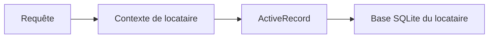

# basecamp/activerecord-tenanted

> Rails gem for hosting several isolated tenants in a single application.

## The problem
Isolating each customer's data in a shared Rails application requires plumbing throughout the code.

## What it actually does
Persists each tenant's data in separate storage and runs code in an isolated tenant context. Aims for code that reads the same as a single-tenant application. Only the sqlite3 adapter is fully supported.

## How it is wired
Simplified diagram based on the fiche, no diagram provided.


## Trying it
```bash
bundle add activerecord-tenanted
```

## Cost and gotchas
Free. Rails and Ruby required. Only sqlite3 is handled for now; other databases are to be discussed with the maintainers.

## What it is not
Not a complete multi-database solution. Detailed configuration is in GUIDE.md, which is absent from the fiche.

## Alternatives
No alternative named in the README.

## For you
Ignore: relevant only for a multi-customer Rails application, outside the data / AI / MLOps scope.
